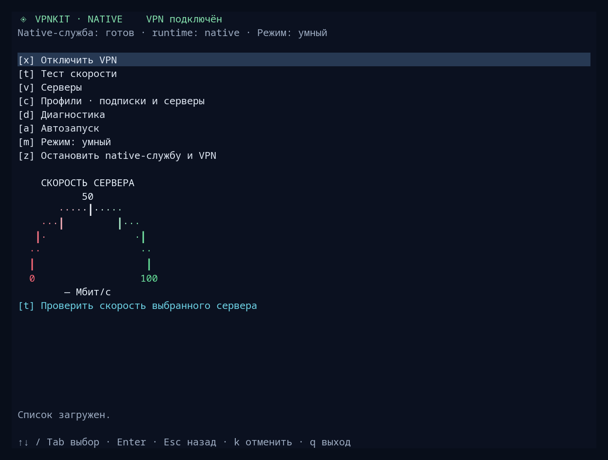
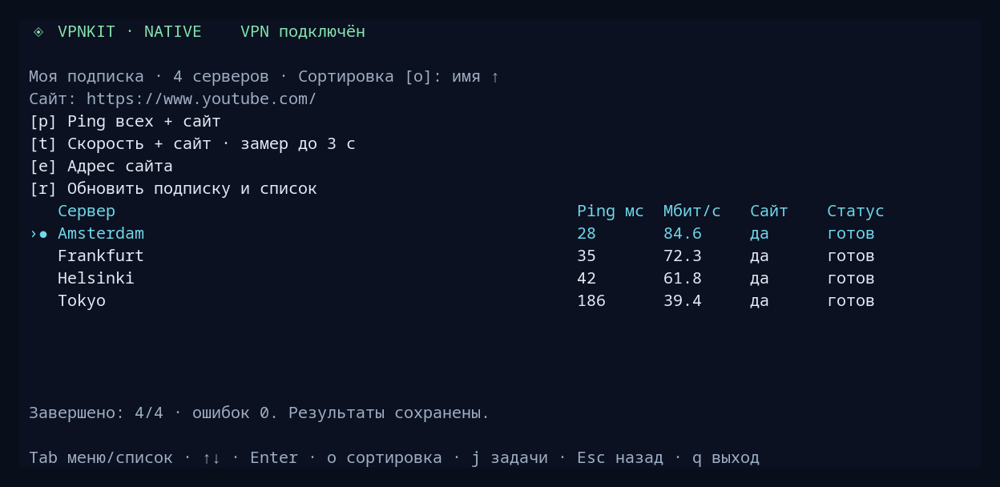
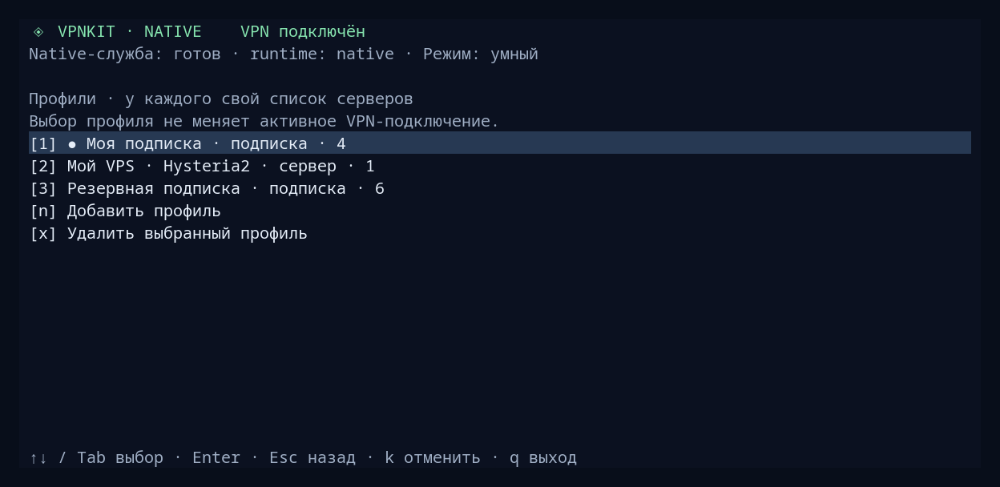

<div align="center">

# Local VPN KDE

**Your servers. Your subscriptions. One terminal interface.**

VPN for Linux and KDE · NetworkManager · Native and Docker

[Русский](README.md) · **English**

</div>



Subscriptions and individual **VLESS / Hysteria2** links, separate server lists, strict and smart routing, autostart and diagnostics — all in one TUI.

## Servers and profiles

Check latency, download speed and access to your chosen website before connecting.



Keep your own VPS alongside multiple subscriptions. Selecting a profile changes the server list; connecting the VPN is a separate action.



<sub>Captures of the actual interface with demonstration data. No private addresses or keys are used; measurements are illustrative. The TUI currently displays Russian labels.</sub>

## Install

Arch / Debian packaging for `v0.2.0`: [candidates and manual CI](docs/native-packages.md). Packages are not published yet.

### Native · Arch / CachyOS x86_64

From a trusted local bundle directory containing `vpnkit-portable`, its checksum and `install-native.sh`:

```bash
sha256sum -c vpnkit-portable.sha256
sudo bash ./install-native.sh
local-vpn-kde
```

Run the installer once with sudo, then launch the interface as your regular user. No Go, Bun or Docker is needed on this computer. Installation does not connect the VPN.

[Build a bundle and see what it contains →](docs/portable-installer.md)

### Docker · Linux x86-64 with KDE

Ubuntu 24.04+, Debian 13+, Fedora, Arch / CachyOS. Run without sudo — the installer requests privileges when needed:

```bash
git clone https://github.com/blockedby/local-vpn-kde.git
cd local-vpn-kde
./install.sh
./run.sh
```

## Get connected

**`c` Profiles** → add a link → **`v` Servers** → select a server → **`s` Connect VPN**. If the service is stopped, start it using the same menu item first.

`m` — routing mode · `a` — autostart · `d` — diagnostics · `x` — disconnect VPN.

## Learn more

[User guide and updates](docs/guide.en.md) · [VPN coexistence](docs/native-coinstall.md) · [Upgrades without disconnecting](docs/native-hot-upgrade.md) · [Testing](docs/native-e2e.md)
