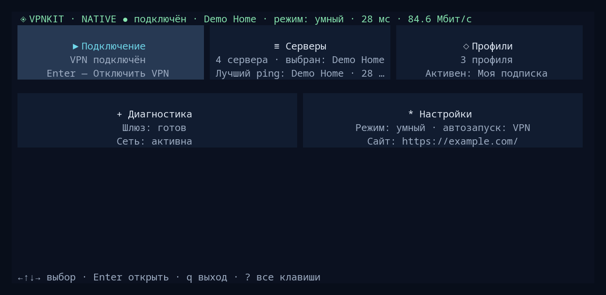
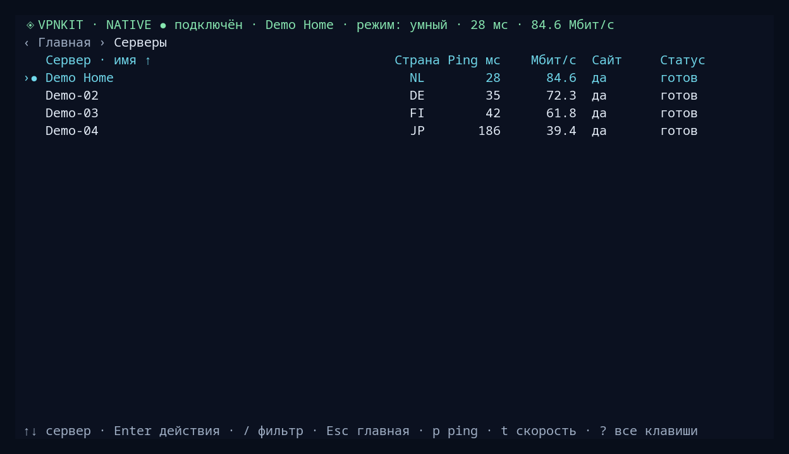
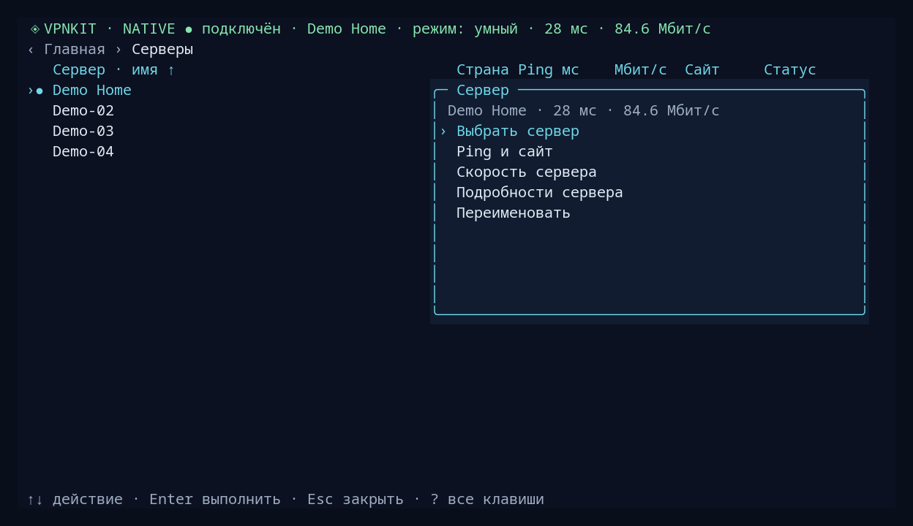
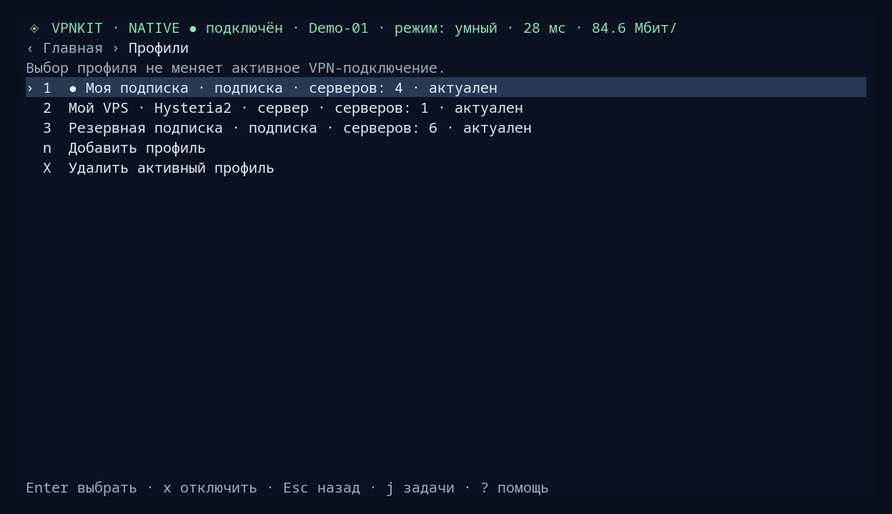

<div align="center">

# Local VPN KDE

**Your servers. Your subscriptions. One terminal interface.**

VPN for Linux and KDE · NetworkManager · Native and Docker

[Русский](README.md) · **English**

</div>



Subscriptions and individual **VLESS / Hysteria2** links, separate server lists, strict and smart routing, autostart and diagnostics — all in one TUI.

## Servers and profiles

Check latency, download speed and access to your chosen website before connecting.





Keep your own VPS alongside multiple subscriptions. Selecting a profile changes the server list; connecting the VPN is a separate action.



<sub>Captures of the actual interface with demonstration data. No private addresses or keys are used; measurements are illustrative. The TUI currently displays Russian labels.</sub>

## Install

### Native · Arch / CachyOS or Debian 13, x86_64

Download the package from the [latest release](https://github.com/blockedby/local-vpn-kde/releases/latest) together with `SHA256SUMS`, verify and install it:

```bash
sha256sum -c --ignore-missing SHA256SUMS
sudo pacman -U ./local-vpn-kde-native-*-x86_64.pkg.tar.zst   # Arch / CachyOS
sudo apt install ./local-vpn-kde-native_*_amd64.deb          # Debian 13
kvpn
```

Launch the interface as your regular user. No Docker is needed on this computer. Installation does not connect the VPN.

Without a package manager: [portable bundle](docs/portable-installer.md).

### Docker · Linux x86-64 with KDE

Ubuntu 24.04+, Debian 13+, Fedora, Arch / CachyOS. Run without sudo — the installer requests privileges when needed:

```bash
git clone https://github.com/blockedby/local-vpn-kde.git
cd local-vpn-kde
./install.sh
./run.sh
```

## Get connected

The interface opens on a home screen with Connection («Подключение»), Servers («Серверы»), Measurements («Замеры»), Profiles («Профили»), Diagnostics («Диагностика») and Settings («Настройки») tiles. Use the arrow keys to choose a tile and `Enter` to open a section or perform the connection action; `Esc` returns from a section to home. In nested screens and menus `Esc` closes those first; in the server table it first clears a filter. A breadcrumb shows the path to the section; `Tab` / `Shift+Tab` cycle through Servers, Profiles, Diagnostics and Settings.

For the first connection, press `c` and add a subscription or link. If the service is stopped, start it using the Connection tile or `s`. Open Servers, refresh the list if needed (`r`), choose a row and press `Enter`. Choose Select server («Выбрать сервер») from the menu and confirm: No («Нет») is selected by default, and Left/Right move between the buttons. Then return home and choose Connection or press `s`. In installed native mode with a configured subscription, `c` opens Profiles.

`m` — routing mode · `a` — autostart · `d` — diagnostics · `x` — disconnect VPN.

The status line shows the connection, selected server and routing mode. `?` opens help, `:` or `Ctrl+P` searches commands, and `j` opens activity. Checks can overlap or wait in a queue; cancel a task from the activity panel.

The table shows name, two-letter country code, ping, speed, website access and status. The Country («Страна») column is hidden when the table is narrower than 60 characters. `Enter` opens the row menu: Select server («Выбрать сервер»), Ping and site («Ping и сайт»), Server speed («Скорость сервера»), Server details («Подробности сервера») and Rename («Переименовать»). `/` filters the displayed and original names and country code, `Enter` keeps the filter and `Esc` clears it. `p` checks ping and website access and `t` checks speed and website access for the shown servers; `T` tests the speed of the row under the cursor and `b` offers the fastest measured shown server for confirmation. `o` cycles sort columns (name, ping, speed, site, country), `[` and `]` choose a column, and `\` reverses direction; clicking a header also sorts it. `l` opens server details, `i` opens settings, and `X` removes the active profile after confirmation. `a` opens autostart; it does not run ping.

Choose Rename from the row menu: `Enter` saves, `Esc` cancels, and an empty line restores the subscription name. A name can be up to 60 characters; surrounding and repeated spaces are removed. You can save up to 500 renamed servers. The local state file `server-names.json` holds server IDs and the chosen names; they survive subscription refresh and restart and are not removed when a profile is deleted. Details show the renamed server's original name.

Country lookup is offline, using the embedded [server-country](https://github.com/sapics/ip-location-db) dataset (public domain, PDDL 1.0); no server address is sent to a country lookup service. A known IP's code is available immediately; for a hostname it may appear after a successful ping, check or speed measurement. TCP ping uses the connected address; a proxy lookup with ambiguous or unknown addresses supplies no new code, and a previously determined code may remain. The embedded database is a snapshot, so a code can become outdated.

## Updates

```bash
kvpn update    # install the new version; the VPN stays connected
kvpn restart   # move a running gateway onto the new version
```

After installing, `kvpn update` offers to restart the gateway (the VPN drops for a few seconds) and to open the interface. The TUI has the same in **Settings → [u]**. See the [guide](docs/guide.en.md#updates).

## Learn more

[User guide and updates](docs/guide.en.md) · [VPN coexistence](docs/native-coinstall.md) · [Upgrades without disconnecting](docs/native-hot-upgrade.md) · [Testing](docs/native-e2e.md) · [Release process (RU)](docs/releases.md)
