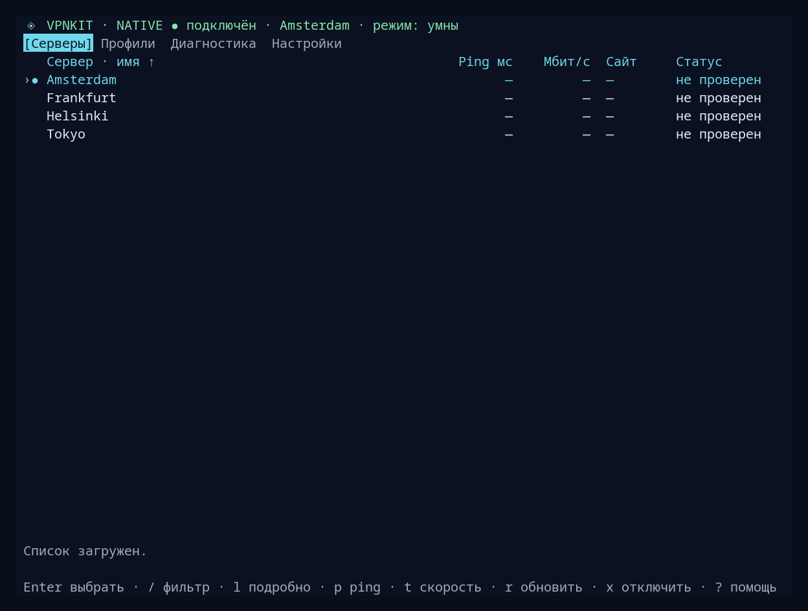
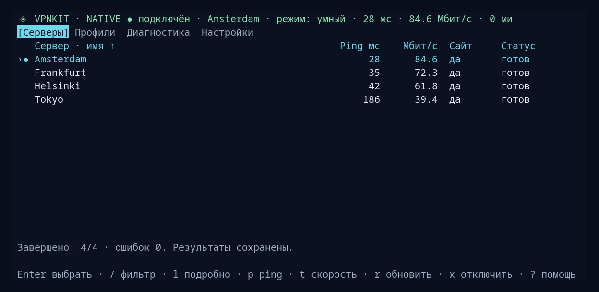
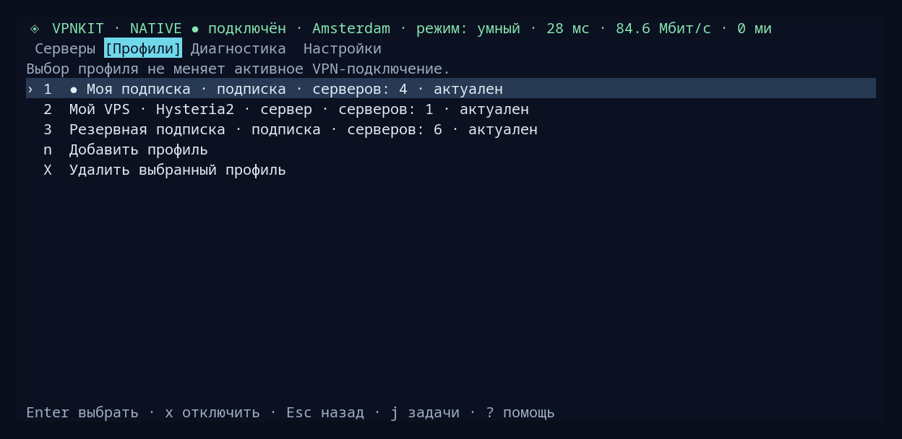

<div align="center">

# Local VPN KDE

**Ваши серверы. Ваши подписки. Один терминальный интерфейс.**

VPN для Linux и KDE · NetworkManager · Native и Docker

**Русский** · [English](README.en.md)

</div>



Подписки и одиночные **VLESS / Hysteria2** ссылки, отдельные списки серверов, строгий и умный роутинг, автозапуск и диагностика — из одного TUI.

## Серверы и профили

Проверьте задержку, скорость и доступность нужного сайта перед подключением.



Собственная VPS и несколько подписок могут жить рядом. Выбор профиля меняет список серверов; подключение VPN — отдельное действие.



<sub>Снимки настоящего интерфейса с демонстрационными данными. Адреса и ключи не используются; результаты замеров иллюстративные.</sub>

## Установка

Подготовка пакетов Arch / Debian для `v0.2.0`: [кандидаты и ручной CI](docs/native-packages.md). Пакеты пока не опубликованы.

### Native · Arch / CachyOS x86_64

Из каталога доверенного локального bundle (`vpnkit-portable`, контрольная сумма и `install-native.sh`):

```bash
sha256sum -c vpnkit-portable.sha256
sudo bash ./install-native.sh
local-vpn-kde
```

Один запуск установщика с sudo; интерфейс запускается обычным пользователем. Go, Bun и Docker на этом компьютере не нужны. Установка не подключает VPN.

[Как собрать bundle и что в него входит →](docs/portable-installer.md)

### Docker · Linux x86-64 с KDE

Ubuntu 24.04+, Debian 13+, Fedora, Arch / CachyOS. Выполняйте без sudo — установщик запросит права сам:

```bash
git clone https://github.com/blockedby/local-vpn-kde.git
cd local-vpn-kde
./install.sh
./run.sh
```

## Начать пользоваться

Нажмите `c`, чтобы настроить первую подписку или ссылку → **`v` Серверы** → выберите сервер → **`s` Подключить VPN**. Если служба остановлена, сначала запустите её той же клавишей. В установленном native с настроенной подпиской `c` открывает профили; их вкладку также можно открыть через `Tab`.

`m` — режим · `a` — автозапуск · `d` — диагностика · `x` — отключить VPN.

После запуска открывается таблица серверов; `Tab` переключает вкладки «Серверы», «Профили», «Диагностика» и «Настройки». Строка состояния показывает подключение, выбранный сервер и режим. `?` открывает справку, `:` или `Ctrl+P` — поиск команд, `j` — задачи. Проверки могут выполняться параллельно или ждать в очереди; отменить задачу можно в панели задач.

В таблице `/` фильтрует имена, `Enter` сохраняет фильтр, `Esc` очищает. `p` проверяет ping и сайт, `t` — скорость и сайт показанных серверов; `T` проверяет сервер под курсором, `b` предлагает самый быстрый измеренный среди показанных с подтверждением. `o` меняет сортировку, `[` и `]` выбирают столбец, `\` меняет направление; заголовок столбца также можно нажать мышью. `l` открывает сведения, `i` — настройки; в профилях `X` удаляет активный профиль после подтверждения. `a` открывает автозапуск и не запускает ping.

## Подробнее

[Руководство и обновление](docs/guide.ru.md) · [Совместная работа с другими VPN](docs/native-coinstall.md) · [Обновление без отключения](docs/native-hot-upgrade.md) · [Тестирование](docs/native-e2e.md) · [Процесс выпуска](docs/releases.md)
